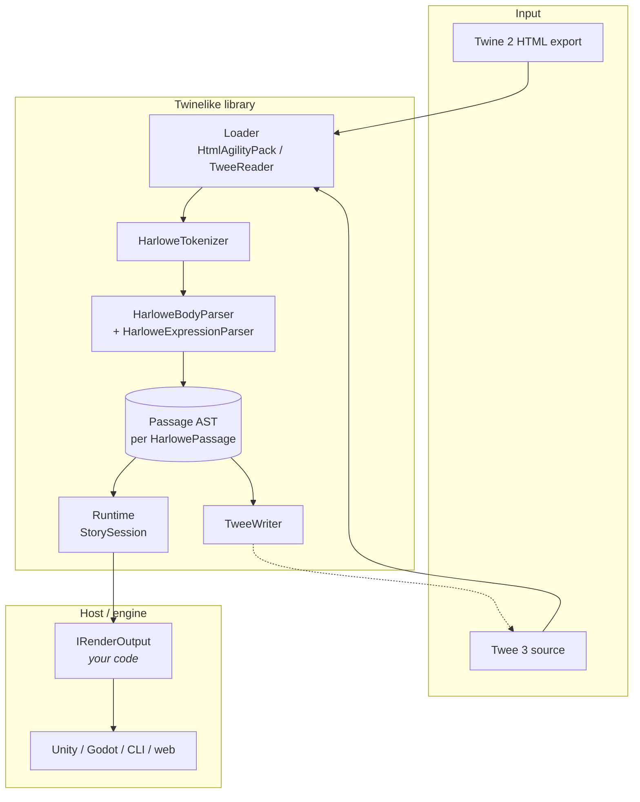
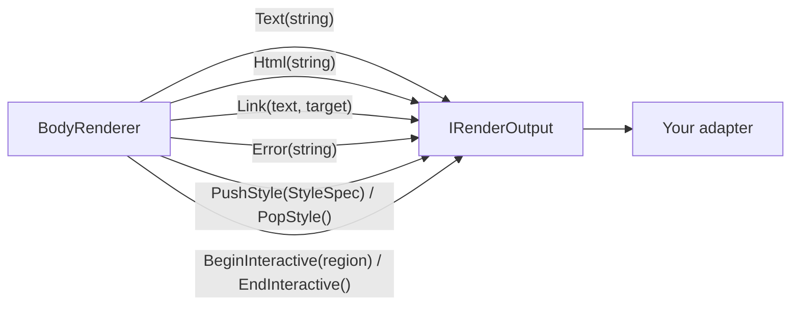
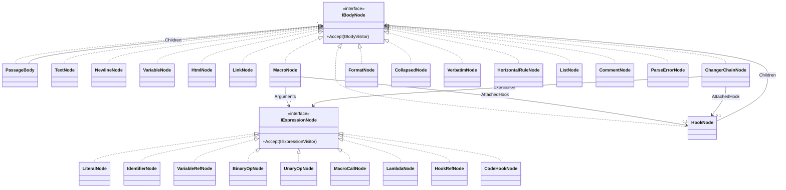
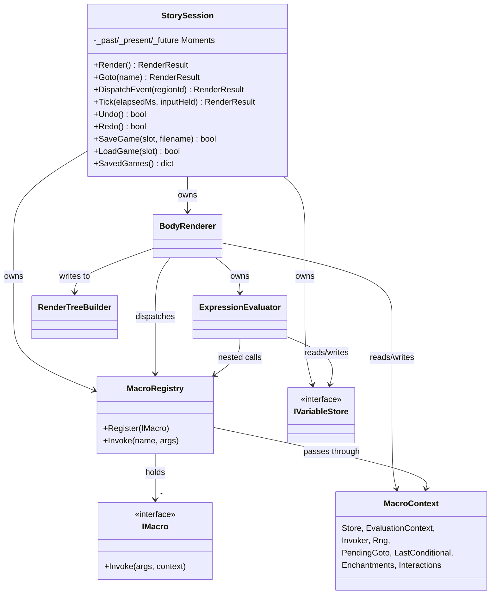
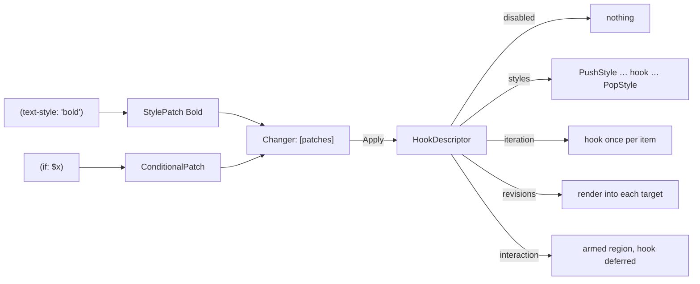

# Architecture

How the library is put together. **Part 1** is for game-engine hosts using it, **Part 2** for contributors working inside it, and a glossary of Harlowe terms closes it. `CLAUDE.md` holds the working rules. `TODO.md`, `MACRO-DIVERGENCES.md` and `COMPATIBILITY.md` hold what's left to do and where behaviour differs from reference Harlowe, and `tools/README.md` describes the test bench that measures it.

---

## Top-level pipeline



A story enters from one of two formats, gets parsed once into a passage AST, then gets *executed* on demand by the runtime — emitting events through your `IRenderOutput` adapter for the host engine to render. Twee 3 is the only output format (HTML emit is out of scope; Twine 2 is the natural HTML producer).

---

# Part 1 — Using the library

## Entry points

```csharp
// Load a story
var story = new HarloweStory(htmlText);            // Twine 2 HTML export
// or: var story = new TweeReader().Read(tweeText); // Twee 3 source

// Inspect / edit
foreach (var p in story.Passages) { ... }
story.AddPassage(new HarlowePassage { Name = "Foo", Body = "..." });
story.RenamePassage("Old", "New");

// Run it
var session = new StorySession(story);
var result = session.Render();                     // first passage
result = session.Goto("PassageName");              // result.Text / result.Entries
result = session.DispatchEvent(regionId);          // a click or hover the player made
result = session.Tick(elapsedMs);                  // once a frame; null when nothing rendered
session.Undo();
session.Redo();

// Persist a playthrough (host storage is pluggable — see ISaveStorage)
session.SaveGame("slot A", "My Save");
session.LoadGame("slot A");

// Save the story itself back to Twee
string twee = new TweeWriter().Write(story);
```

`StorySession` is the surface most consumers want. `HarloweStory` itself is the static story model (passages + metadata); the session adds runtime state (current passage, variable store, the undo/redo timeline, visit trails).

Use a session from one thread at a time. Sessions share no mutable state, so separate sessions can run on separate threads, even over one `HarloweStory`, as long as nothing edits that story while they play.

## The IRenderOutput contract

`IRenderOutput` is the pipeline's event vocabulary. Eight core channels — four flat, two bracket pairs — frozen, because adding a member breaks every host that implements it. `StorySession.Render()`/`Goto()`/`DispatchEvent()`/`Tick()` return the events materialised as `RenderResult.Entries` (each `BufferedRenderOutput.Entry.Kind` mirrors one output method); walk that list after each call to drive your engine's renderer, or stream it with `RenderResult.ReplayTo(output)`. Implement the interface itself when driving `BodyRenderer` directly or writing a translating adapter like the built-in `HtmlRenderOutput`.



| Channel | What it carries | When emitted |
|---|---|---|
| `Text` | Plain prose | Always |
| `Html` | Raw author HTML in passage source, plus the tags of markup that has no channel of its own | When the author writes literal `<b>foo</b>`; for `---` (`<hr>`); for a list, `<ul>`/`<ol>`/`<li>` and their closes, one event per tag, always balanced |
| `Link` | Text + target passage name | For `[[passage]]` links whose label is plain prose (the common case) |
| `Error` | Inline error message | Failed expression / unknown macro / arity mismatch |
| `PushStyle` / `PopStyle` | `StyleSpec` (semantic styling layer) | Changer macros entering / leaving scope |
| `BeginInteractive` / `EndInteractive` | `InteractiveRegion` (id + kind) | Click/hover macros arming a region — report the user's event back via `StorySession.DispatchEvent(regionId)` |
| `BeginLink` / `EndLink` (optional, `ILinkLabelOutput`) | Target passage name | Instead of `Link` when a link's label carries structure (styles, armed regions, HTML or errors, e.g. after `(replace: ?link)[''bold'']`) — the label arrives as ordinary events in between; render both shapes as the same navigable link |

**Later channels are optional features.** Each is a capability interface plus a *lowering* to core channels, so a host only receives event kinds it opted into. An adapter opts in by implementing the interface; a host walking `Entries` has no adapter to inspect, so it sets `StorySession.OutputFeatures`. Without `ILinkLabelOutput`, a structured label flattens to one `Link`: its styling, armed regions and HTML are dropped and its errors move to just after the link. One internal `OutputFeatureAdapter` makes every forward-or-lower decision, because a wrapper per feature would hide a host's support for the others. For the same reason, a host's own wrapping adapter must implement and forward a capability interface, or the output behind it gets the lowered form.

**Style is semantic, not HTML.** A `StyleSpec` describes one styling layer with named flags (`Bold`/`Italic`/`Underline`/`Strikethrough`) and value fields (`Color`/`BackgroundColor`/`FontFamily`/`FontSize`). You map it to whatever your renderer accepts — TextMeshPro tags for Unity, BBCode for Godot, ANSI for a terminal, HTML for a browser. The library never bakes in HTML. Transitions arrive the same way, as the `Transition*` fields of a hook's innermost layer: the name of how it should appear, with times in milliseconds, or around a passage link, how the passage should leave and the next arrive. Harlowe's transitions last 800 ms unless the story sets a time.

For browser hosts, `HtmlRenderOutput` is a built-in adapter that wraps an inner `IRenderOutput` and translates style events to HTML on the way through — replay a render's `Entries` into it, or use it as a reference impl when writing your own:

```csharp
var html = new HtmlRenderOutput(new MyStringSink());
session.Render().ReplayTo(html);   // dispatch each entry to its output method
```

`HtmlRenderOutput` escapes what `IRenderOutput` says is text — `Text`, a link's text and `Error` — and forwards `Html` and link targets raw. Bold, italic, underline and strike become short tags, and any value field becomes one `<span style="…">` with its values attribute-escaped. An optional `interactiveHref` sets interactive regions' `href` (`javascript:void(0)` by default, empty to leave it out), and wrapping one `HtmlRenderOutput` in another throws, since that would escape everything twice.

## Errors are in-prose, never thrown

A bad expression (`(set: $x to "five" * 2)`, unknown macro, type mismatch) produces an `Error` event at the point it happened. The rest of the passage continues to render. No `try/catch` needed around `Render()` / `Goto()` for runtime errors. Parse-time failures are recovered too — the loaders catch `HarloweParseException` and substitute an in-prose error stub for the broken passage (or the broken node, with well-formed siblings still parsing). Loading throws only when the file as a whole is unusable: `HarloweParseException` for HTML with no `<tw-storydata>`, a `<tw-passagedata>` with no `name` or `pid`, two passages with one name or pid, or a `:: StoryData` that isn't a JSON object.

```
[story prose]      Text("You see ")
[bad expression]   Error("_missing is not set")
[continues]        Text(", and the door creaks.")
```

Engines decide what to do with errors — render them inline in red, log to console, silence in production builds.

## Variables, undo, and saving

Two namespaces: **story-scoped** (`$foo`, persists across passages) and **temporary** (`_foo`, belongs to the hook it's set in and ends with it). The session also tracks a per-passage visit count and an `it` slot for shorthand expressions.

The session runs on a `Moment[]` timeline — completed turns behind, the live turn, undone turns ahead for `Redo()`. Each moment stores its turn's forward `$`-variable delta, its visit trail, and sparse RNG state; `visits`, `(history:)`, and `turns` are derived from the trails. `Undo`/`Redo` restore the store and RNG to the target turn's *start* and re-render it, so relative `(set:)`s aren't double-applied and `(random:)` reproduces. Memory grows linearly with turn count, fine for typical stories.

`SaveGame(slot, filename)` / `LoadGame(slot)` / `SavedGames()` persist that timeline through an `ISaveStorage` backend you supply at session construction (in-memory default; `null` disables saving; slot keys are IFID-namespaced so one backend can serve multiple stories). Values serialise as re-evaluable Harlowe source; loading is atomic — a corrupt or version-newer blob returns `false` without touching live state. The author-facing `(save-game:)`/`(load-game:)`/`(saved-games:)` macros ride the same path. A save reproduces the present turn by rendering it again, so a `(set:)` that a click or a live hook ran on the current passage, with no navigation since, isn't part of it.

### Host-facing state

Two additive extensions let a host read state and keep its own per-turn data. Both are invisible to story code and change nothing about Harlowe semantics.

- **Time.** The story's clock moves only when the host calls `StorySession.Tick(elapsedMilliseconds, inputHeld)`, once a frame from a game loop, with `inputHeld` true while the player holds any key, mouse button or touch. `time` reads the clock, so it's 0 while a passage first renders, and each call is one frame for the passage's `(live:)` hooks, which render once their delay has passed, and its `(after:)` hooks, which render once `time` passes theirs. A held input speeds an `(after:)` up when it asks for that. `Tick` returns the page when one rendered and null otherwise, and `HasLiveHooks` says whether there's anything to tick for. What a live render changes isn't part of a save, as with a click. Inside `{…}`, a live render or a click's reveal collapses its own whitespace as it finishes and leaves the rest of the page as it was, as reference does, so it can leave a double or trailing space a browser would show as one.
- **Variable reads.** `TryGetVariable(name, out value)` (with or without the `$`) and `GetVariableNames()` read the story (`$`) namespace. Values are deep copies and reads have no side effects (no `it` update, no delta, no RNG draw). There is deliberately no host write: a write from outside the story wouldn't be recorded as part of a turn, so undo and saves couldn't reproduce it. The reads see the live store — the state on screen after `Render`/`Goto`/`DispatchEvent`, and a restored turn's *start* between `Undo`/`Redo`/`LoadGame` and the next `Render`.
- **Turn data.** `TurnData` is an opaque string on the present turn's `Moment`, for whatever the host wants to remember about that turn; the runtime never reads it. Because it lives on the moment, the timeline carries it for free — undo/redo move it, a `Goto` after an undo discards the abandoned branch's data with the branch, and save/load round-trip it. `GetTimeline()` returns a detached list of every turn (resting passage + data), oldest first, excluding the redo future. Blobs are stamped with the lowest version that can represent them, so a session that uses none of turn data, a deleting `(move:)` or a typed variable writes byte-identical version-1 blobs that older builds still load.

## Editing the story object model

`HarloweStory` exposes mutation: `AddPassage`, `RemovePassage`, `RenamePassage` (re-keys the lookup; direct `passage.Name = "..."` mutation is a silent footgun), public setters for metadata. Assigning a passage's `Body`/`RawBody` re-parses it, so the runtime and the diagnostics below see the edit, and `TweeWriter` writes the new source as it is. `RenamePassage` edits the source of the passages linking in the same way. `HarlowePassage.IsDirty` is the flag for an edit made to the `Ast` instead: the library never sets it, and a passage carrying it is re-canonicalized through `MarkupPrinter` on write. Cross-tool diffs through Twee stay scoped to actually-edited passages.

### Load-time diagnostics

Three report APIs exist for the same reason: the engine is deliberately tolerant, so nothing *forces* an authoring mistake to surface. Inline errors only fire when a player reaches them, a broken passage doesn't abort a load, and an unrecognised format version still plays. A problem down an unplayed branch therefore stays invisible until it ships. All are meant to be called once at load by a host engine, which shows the results to whoever is building the story — so each entry carries a ready-to-print `Message` (the two passage-scoped ones also carry passage, line, and column).

- **`GetParseErrors()`** — every passage that didn't parse. `ParseError.IsWholePassage` distinguishes a dead passage (the loader substituted an error stub; nothing else in it will render) from one the body parser *recovered* inside (one bad construct, the rest still works). Errors nested in hooks are found.
- **`GetBrokenLinks()`** — every navigation reference pointing at a passage that doesn't exist: the `[[…]]` syntax *and* a literal passage name given to `(goto:)`, `(display:)`, `(link-goto:)`, or the `(click-goto:)` family, including calls nested in hooks and expressions. Also the answer to what `RemovePassage` leaves behind — deleting a passage silently orphans every reference into it. Computed targets (`(goto: $next)`) are undecidable statically and skipped.
- **`GetCompatibilityNotices()`** — how the story's declared `format-version` was interpreted. Empty when it names a Harlowe major this library implements; otherwise one notice saying which profile is running and why (no version declared, a major too new to recognise, an unparseable version, a pre-3.x version clamped to Harlowe 3, or a host override setting the declaration aside). `Info` for defensible defaults, `Warning` when the declared version couldn't be honoured as written.

The first two walk the AST through internal visitors in `BodyVisitors.cs` (`ReferenceCollector`, `ParseErrorCollector`), which is why `LinkNode`, `MacroNode`, and `ParseErrorNode` carry source positions — the diagnostic has to be able to point at something. The third reads story metadata only.

Links fail safe at render time too: a `[[…]]` whose target is absent emits **no link event at all** (just its label as prose, plus an inline error), and `StorySession.Goto` refuses an unknown passage without touching session state — so a dead link can't strand the session on a nonexistent passage and write that name into a save the player could then never load.

---

# Part 2 — Internal architecture

## Five load-bearing decisions

Everything else is built on these. Work with them rather than around them.

- **Descriptor-patch changers** (matches reference). A `Changer` is a flat `List<IChangerPatch>` over a `HookDescriptor`. New changer kinds drop in as new patch types and descriptor fields, so `Apply` never grows a top-level branch you can't isolate.
- **A render tree between `BodyRenderer` and `IRenderOutput`.** An addressable, mutable representation of rendered content, so revision, enchantment and interaction macros have something concrete to target. `RenderTreeBuilder` *is* an `IRenderOutput`, which is why `Changer.Apply` retargets onto the tree for free.
- **Semantic event channels on `IRenderOutput`.** `PushStyle`/`PopStyle` and `BeginInteractive`/`EndInteractive` are the bracketing primitives engines map to native UI. The interface is frozen at its eight 0.2.0 members, because adding one breaks every host. A later channel is an optional feature: a capability interface (`ILinkLabelOutput` carries `BeginLink`/`EndLink`), an `OutputFeatures` flag for hosts walking `Entries`, and a lowering to core channels in the one internal `OutputFeatureAdapter`.
- **Hook-scoped temp variables** (matches reference's `ts/internaltypes/varscope.ts`). A stack of dictionaries pushed at every hook; `Set` writes to the nearest declaration. Story variables stay one flat namespace. `(for:)`, lambdas and nested hooks rely on this, and saves serialise only the story namespace.
- **The `Moment[]` timeline** (matches reference's `ts/state/moment.ts`). Each turn is a forward `$`-variable delta, a redirect trail and sparse RNG state, with `visits`, `(history:)` and `turns` derived from the trails. Undo, redo and load restore a turn's start and re-render it.

## Two-layer parsing

```
Layer 1 — Host                                    Layer 2 — Harlowe markup
─────────────────                                ──────────────────────────────
HTML  → HtmlAgilityPack → tw-passagedata bodies ─┐
                                                  ├──► HarloweTokenizer ─► Tokens
Twee  → TweeReader      → :: header bodies      ─┘                         │
                                                                            ▼
                                                                  HarloweBodyParser
                                                                            │
                                                                            ▼
                                                              (delegates macro args to)
                                                                            │
                                                                            ▼
                                                              HarloweExpressionParser
                                                                            │
                                                                            ▼
                                                                     PassageBody AST
```

Layer 1 has two front-ends; Layer 2 is shared. HtmlAgilityPack extracts `<tw-storydata>`/`<tw-passagedata>` and decodes entities with `HtmlEntity.DeEntitize`, so `->`/`<-`/quotes reach the tokenizer unencoded. `TweeReader` splits on `:: Name [tags] {position}` headers at column 0, reads `:: StoryTitle`/`:: StoryData` (a hand-rolled `JsonReader`, applied before any body is lexed because its `format-version` picks the profile), and synthesizes sequential pids. Both populate `HarlowePassage.RawBody`, so `TweeWriter` emits clean passages verbatim and re-canonicalizes only `IsDirty` ones through `MarkupPrinter`. `HarlowePassage.Body`/`Branches` are derived from the AST by visitors.

## Tokenizer

The tokenizer keeps a stack of `Frame { Mode, ParenDepth }`, Body or Expression with a paren depth per frame, so `)` is told apart as `ParenClose` or `MacroClose`. An `_inLink` flag suppresses macro and hook markup inside `[[…]]`.

```
   Body                       Expression
  ┌──────────────┐    "("    ┌──────────────────┐
  │ prose tokens │ ────────► │ operator/literal │
  │ macros, [    │ ◄──────── │ tokens, parens   │
  │ links [[     │    ")"    └──────────────────┘
  └──┬───────────┘
     │ "[[" sets _inLink (suppresses macro/hook recognition until "]]")
     ▼
   Link
```

It covers every `TokenType` and operator in the manual's precedence table. Multi-word operators (`is not`, `is in`, `is a`, `does not contain`, …) fuse at lex time; the whitespace-sensitive `'s`, the digit-leading `2bind`, the `-type` typed-variable suffix and the datatype names (`num`, `string`, `even`, …, case-insensitive, outranked by property-name position so `$dm's num` still reads a key) have dedicated scans. In body mode it also produces the inline-format delimiters (`''`, `//`, `~~`, `^^`, doubled only, plus `*` and `**`), whole `` `verbatim` `` spans, `---` rules, list markers where a block may start, a `scheme://…` URL token consumed whole so its slashes never become italics, and the comment tokens: `--` in both modes (suppressed inside links) and a whole `<!-- … -->` in body mode. String literals are cooked at lex time with the JavaScript escape set. Lex-time mistakes (`gt`, `=>`, `#ff`) become a `TokenType.Error` token rather than throwing, so they recover per node like any parse error.

`MarkupFronts` is reference's `frontTokenStack`: it pairs hooks, `{…}`, inline formats and verbatim across the passage and records each pair in `Token.Partner`. A token with no partner is literal text, and surviving pairs always nest. A `[` in expression mode opens a **code hook**, a Body frame with its own `MarkupFronts`, so markup inside can't pair with markup outside.

## Parsers

Both parsers live in `Parsing/` and share a `TokenCursor`, which the body parser hands to the expression parser at every macro argument list. `HarloweExpressionParser` climbs precedence (a lower order binds tighter); binary operators are left-associative except `of`, and `and`/`or` share an order. Branch links take all three separators (`[[text->target]]`, `[[text|target]]`, `[[target<-text]]`) with reference's rule for several: the rightmost `->`/`|` wins, else the leftmost `<-`, and unchosen separators stay text. A pure variable target (`[[Go->$next]]`) resolves through the store at render time.

**Parse errors recover.** Loaders (HTML, Twee, `AddPassage`) catch `HarloweParseException` and substitute a `ParseErrorNode` stub through `HarloweStory.MakeParseErrorAst`. The body parser also recovers per node: a failure in `ParseNodes` becomes a `ParseErrorNode`, then `TryAdvanceToResumePoint` moves to the next safe point — a newline at the same hook depth, or exactly the macro-close parens the failed node still owes (`TokenCursor.NetMacroDepthSince`) — so a well-formed sibling, even a macro right after the broken construct, still parses. `HarloweStory.DecorateParseErrors` prefixes nested errors with the passage name, and `TweeWriter.ResolveBody` round-trips a wholly-failed passage from `RawBody`.

## Two AST trees

Same `(name: ...)` syntax means different things in body position vs. argument position, so the AST splits.



- **Body nodes** describe rendered prose: text, hooks, links, macros that *do something* in body position (`(if:)`, `(set:)`, `(for:)`).
- **Expression nodes** describe macro arguments: literals, operators, nested calls, lambdas, `?hook` references with ordinal narrowing, code hooks. Collection literals `(a:)`/`(dm:)`/`(ds:)` are `MacroCallNode`s.
- A macro in body position is `MacroNode`; the same syntax in an arg list is `MacroCallNode`. Different lifecycle, different visitor.
- `FormatNode` is inline formatting: the body parser folds the tokenizer's paired delimiters into one node with an `InlineFormat`, and the renderer maps it to the same `StyleSpec` flag `(text-style:)` sets (`*` is italic, `**` bold).
- `ChangerChainNode` is `$var[hook]`, with the whitespace before the hook kept as `HookGap`. Inline composition, `(m1)+(m2)[hook]`, stays as sibling nodes, because only a changer joins a `+` and that isn't known until the macro runs.
- `LinkNode`, `MacroNode` and `ParseErrorNode` carry a 1-based `Line`/`Column` (0 when unknown) for the diagnostics. `CommentNode` and `ParseErrorNode` keep their `OriginalSource` so `MarkupPrinter` round-trips them; `ParseErrorNode` splits its printed `Message` from a structured `Detail`.

Both trees use the visitor pattern. Adding a new node type means a `Visit(NewNode)` method on its visitor interface, which forces every existing visitor to acknowledge it (compile-time enforcement, no missing-case bugs).

## Visitor implementations

| Visitor | Tree | Purpose |
|---|---|---|
| `BodyRenderer` | Body | Renders a passage into the render tree |
| `ExpressionEvaluator` | Expression | Reduces a tree to one `HarloweValue` |
| `MarkupPrinter` | Both | Canonical Harlowe-source emission for Twee write-out |
| `BranchCollector` (internal) | Body | Derives `HarlowePassage.Branches` from `LinkNode`s |
| `ReferenceCollector` (internal) | Both | Every passage reference, links and navigation-macro literals, for `GetBrokenLinks` |
| `ParseErrorCollector` (internal) | Body | Every `ParseErrorNode`, hooks included, for `GetParseErrors` |

The three internal collectors live in `BodyVisitors.cs`. When a new body node lands, every `IBodyVisitor` implementation needs a `Visit` override — usually a no-op or a recurse-into-children.

## Runtime composition



`MacroContext` is the per-render bag of state that crosses between the renderer, evaluator, and macros: the variable store, the RNG (seedable for deterministic tests), the passage-render callback for `(display:)`, the registered enchantments and interactions, the nesting budgets, and two short-lived flags:

- **`PendingGoto`** — `(goto:)` writes here; the renderer checks before each sibling and aborts mid-passage to follow the goto.
- **`LastConditional`** — the conditional pairing flag (reference's `lastHookShown`). Written only by `BodyRenderer` at hook-application time: a shown attached hook (changer or boolean) sets true; a hide sets false only for attached booleans and expressions fronted by `if`/`unless`/`else` (an `(else-if:)` hide, or one from a stored changer in a variable, preserves the prior value). `(else:)`/`(else-if:)` read it at call time to bake their decision. Each rendered hook is its own scope for it, so a conditional inside a hook can't pair with an `(else:)` outside.

`MacroRegistry` is a flat name-to-`IMacro` directory that also implements `IMacroInvoker`, so the evaluator can dispatch nested `MacroCallNode`s. Names are case-, dash- and underscore-insensitive. `StandardMacros.RegisterAll` wires up every built-in. `ExpressionEvaluator.EvaluateMacroArguments` expands a top-level `...` before arity checks, so an array given without one is a single item.

## Render sequence

```mermaid
sequenceDiagram
  actor App as Host app
  participant Session as StorySession
  participant Renderer as BodyRenderer
  participant Tree as RenderTreeBuilder
  participant Passes as Collapse / interaction / enchantment passes
  participant Output as RenderTreeFlusher → IRenderOutput

  App->>Session: Goto("Forest")
  Session->>Session: start a new Moment, count the visit
  Session->>Renderer: render startup passages (first turn), then the passage
  loop each node
    Renderer->>Tree: text, hooks, links, errors, styles
    Note over Renderer,Tree: macros evaluate; changers apply to their hooks;<br/>revisions render into earlier targets; (goto:) stops the render
  end
  Session->>Passes: collapse {…} whitespace, arm interactions, apply enchantments
  Session->>Output: flush the finished tree as events
  Session-->>App: RenderResult
```

A dispatch or a tick renders only what changed, into the live tree, then runs the passes and flushes again. The whole passage is never re-rendered.

## Evaluation and assignment

`ExpressionEvaluator` (an `IExpressionVisitor` producing `HarloweValue`) and `BodyRenderer` share the `MacroContext`. Errors propagate as `HarloweValue.Error`, every operator short-circuits on one, and they leave through `IRenderOutput.Error`, never thrown.

**Assignment.** `to`/`into` is handled by the evaluator, property chains included: `(set: $person's name to "Bob")`, `'s`/`of` chains, computed accessors evaluated once. The target path is resolved and checked *before* the right side runs, so an error makes no change; `it` binds to the slot's current value; and the write rebuilds the chain **copy-on-write** (a shallow clone per level, reference's `#mutateRight`, siblings shared) then sets the root again, so the turn's delta sees it. The `random` data name resolves to a concrete position through the session RNG when the path resolves, which is why assigning through it is legal. `(set:)`/`(put:)`/`(move:)` are near no-ops: the work happens during argument evaluation, where `ValidateAssignmentOperators` (reference's type-check pre-pass) checks every argument's operator before any runs, so `(set: … into …)` errors with reference's wording and assigns nothing.

**`(move:)` and `(unpack:)`.** `EvaluateMacroArgument` routes a `(move:)` `into` through copy-then-delete: source read and delete share one frozen path, the destination is assigned first, then the source is deleted — a slot through `ApplyDelete` (array position spliced, datamap key removed, string code point excised), or a whole variable through `IVariableStore.Delete`, recorded as a null in the turn's delta. A deletion that can't happen, like `length`, is skipped silently, as reference ignores `src.delete()`'s result. `(unpack:)` destructures on the same path: its destination is a literal `(a:)`/`(dm:)` pattern walked as AST (`Destructure`), where variables and property chains bind, every other position must `matches` the source, nested patterns recurse, and bindings run in reverse, which is what lets `(move:)` take the same patterns and delete each bound source slot from the end.

**Conditionals are changers.** `(if:)`/`(unless:)`/`(else-if:)`/`(else:)` return changers whose `ConditionalPatch` ANDs into `HookDescriptor.Enabled`, so `(if: $x) + (text-style: "bold")` composes and stores like any changer, and a disabled descriptor applies nothing. An unattached changer in prose is an in-prose error, as in reference.

**Datatype comparisons** are reference's pair in `ts/utils/operationutils.ts`: `is a`/`is not a` demand a datatype on the right, while `matches`/`does not match` are structural equality in which a datatype on *either* side is satisfied by the other side being of that type. That's what makes a collection with datatypes in it a pattern, and it's the same walk `(unpack:)` uses.

**Lambdas.** `LambdaNode` covers every clause shape (`where`/`via`/`making`/`each`, implicit `it`) through nullable clause fields, and `LambdaValue` wraps it as an opaque value. `LambdaInvoker` is the one path every lambda-consuming macro uses: it binds the parameter, `it` and the 1-based `pos` through `IDisposable` scope helpers and evaluates the clause with a fresh evaluator. Lambdas see the caller's store when they run; there's no closure capture.

**Datamap names** (`DataName`) are a string or a number, as in reference's JavaScript Maps; a string converts implicitly. `CheckDataName` is reference's `isValidDatamapName`: it refuses a string beside the number JavaScript reads it as, and the other way round. A number name can be read but not written or deleted through.

**Datasets** keep unique values in the order added, which is how they print. `...` and their save source sort them with `NaturalOrder`, and `is` ignores order (the 4.0 fix, applied to every profile).

## Changers

A `Changer` carries a flat list of `IChangerPatch`. Applying it builds a fresh `HookDescriptor` (enabled flag, styles, iteration, revision targets, interaction, transition, live timing) by running every patch, then executes the descriptor: record a persistent interaction if `Interaction` is set; else loop if `Iteration` is set, running any revision once per pass; else render into the targets if `Revisions` is non-empty; else push the styles, one render node holding them all, render the hook and pop. `(text-style:)` → `StylePatch`, `(for:)` → `IterationPatch`, `(replace:)`/`(append:)`/`(prepend:)` → `RevisionPatch` (appending targets with a duplicate filter, reference's `newTargets`, so composed revisions accumulate), click and hover → `InteractionPatch`, the transitions → `TransitionPatch`. `Compose` concatenates patch lists, which is all `+` does. A story's `+` refuses past `Changer.MaxPatches` (1,024 patches), since a changer added to itself doubles; `Compose` itself doesn't check.



`Changer.Apply`'s render callback is an `Action<IRenderOutput>`: usually the live output, a placeholder's builder for each revision target, or stashed for an interaction. `Changer.ApplyTo(IRenderContainer, Enchantment source)` is the entry for `(change:)`/`(enchant:)`, wrapping an *already-rendered* node's children in the changer's style layers; the optional source tag lets the enchantment pass re-run idempotently. Transitions merge into one `StyleSpec`, the innermost layer, added only when it names a transition, except that around a passage link a time on its own stays, since it sets the passage transition's length. Each `Changer` carries the `Source` it was made from, stamped at macro calls and `+`, which is how it saves.

## Attachment and commands as values

The parser attaches a hook directly after a macro or variable and records the whitespace between as `HookGap`; the rest is decided at render (`BodyRenderer.FollowChanger`, reference's `runExpression`). Only a changer removes that gap. An error replaces the expression and a boolean shows or hides the hook, and both keep the gap; other values print, then the gap and the hook. A changer with no hook walks its siblings past whitespace, `<br>` and comments: a `+` and another expression compose (a `+` after a non-changer is prose), a hook or named hook takes it, and a command takes it at the command's own position. An expression that can't attach reports in the changer's place, and its own hook still renders. A named hook hidden by a false condition stays in the tree, empty, so a revision can still fill it.

In an expression a built-in command is a `CommandValue` (`[[…]]` is `(link-goto:)`), so `(set: $c to (go-to: "x"))` waits until `$c` reaches prose. `BuiltinCommands` records each one's 3.3.9 role: takes a changer, ignores one (`(go-to:)` runs even under `(if: false)`), refuses one, or is an assignment, which runs when evaluated and can't be stored.

## Render tree

`Runtime/Rendering/` sits between `BodyRenderer` and `IRenderOutput`: an addressable, mutable picture of what's rendered, the analogue of reference's `<tw-hook>` DOM. `BodyRenderer` renders into a `RenderTreeBuilder`, which is an `IRenderOutput` plus `BeginHook`/`EndHook` and `BeginInteractive`/`EndInteractive`, and `RenderTreeFlusher` replays the finished tree as the flat event stream.

- `RenderHookNode` is the addressable unit (anonymous hooks get one with a null name). `RenderInteractiveNode` brackets a click or hover region. `RenderStyleNode` holds a changer's layers, outermost first, and carries `SourceEnchantment` and `SourceRegionId` tags so passes can find what they wrapped.
- `RenderLinkNode` is a container, the `<tw-link>` analogue: revisions render into it and string targets match inside it, while styling and arming wrap *around* it, as reference's `<tw-enchantment>` does. It flushes as a flat `Link` while its label is plain prose, and as `BeginLink`/`EndLink` to an `ILinkLabelOutput` when the label carries structure.
- `HookResolver.Resolve` is reference's `selectHook` (`?passage`/`?page` → root, `?link` → links, named → hooks). `TextOccurrenceFinder` wraps literal substring matches as addressable hooks, matching over the tree's flattened text so a match can cross container boundaries (reference's `findTextInNodes`), and moves every fragment of one match into a single wrap (`wrapAll`), so one match is always one node downstream.

## Revisions, hidden hooks, `(show:)` and `(hide:)`

**Revisions render in place** (`Changer.RenderInPlace`, reference's `ChangeDescriptor.render`): every target is resolved first, each gets an empty placeholder (its only child, the last or the first), and then each placeholder gets its own rendering of the hook, so side effects run once per target and a revision inside the content lands on top. A target still being written has what's written so far moved aside first (`RenderTreeBuilder.MoveAside`). While the passage renders, a revision only reaches what's before it, after ordinals pick (`HookResolver.ResolveBefore`), and a changer written in a placeholder a revision has emptied does nothing (`WritesIntoCutContent`), as reference's orphaned expression can't find its hook. Clicks, live hooks and `(show:)` render the same way.

**Hidden hooks.** `|name)[…]`, `[…](name|` and `|name)[=` set `HookNode.IsHidden`. A hidden hook, or a named one hidden by a false condition, is an empty `RenderHookNode` whose `Hidden` holds how to render it and the temp scopes it was written in. `(show:)` clears `Hidden` and renders into the node, looking in both the live tree and the one still being built, so a hook written in the same click's content can be shown. A changer written before `(show:)` styles the revealed hook, and a false one stops it. `(hide:)` moves a hook's rendered children into `Hidden.Detached`, and `(show:)` puts them back as they were. Hooks, links and the `RenderRoot` are `IHideable`; one still being built is hidden when it finishes, because reference renders a hook's content before running its macros.

## Enchantments and interactions

**Enchantments** are persistent restylings. `(enchant: target, changer)` takes a `?hook` or a string (each occurrence wrapped per pass) and a changer or a `via` lambda evaluated per non-empty match with a 1-based `pos`. The changer must be enchantable: `Changer.CanEnchant` refuses revision and interaction patches (reference's `notRevisionChanger`). It registers an `Enchantment`, and `EnchantmentPass.Update` runs over the finished tree after every render and dispatch (reference's `updateEnchantments()`). The pass is **idempotent**: it unwraps everything tagged with its source first, then re-applies. Lambda evaluation restores `PendingGoto`/`PendingLoad`, so pass-time macros can't clobber a dispatch's queued navigation. `(change:)` is the one-shot sibling: it applies at once through the same `EnchantmentPass.Apply`, untagged.

**Interactions** mirror enchantments. Click and hover macros take a `?hook` or a string target plus an optional changer or `via` lambda styling the *armed* region, and record an `Interaction` (target, styling, composed styles, deferred hook renderer, combo mode, once flag, kind, stable region id) rather than wrapping inline. A plain macro also plants an anonymous reveal anchor at its own position. `InteractionPass.Update` runs after the render and every dispatch: it strips every interactive wrap, re-resolves each interaction against the whole tree, wraps its non-empty matches in a `RenderInteractiveNode` and rebuilds the `ClickHandlers` registry. Re-resolving every pass is what makes a forward-referenced `(click: ?b)` and click chains work.

**Dispatch.** The host reports an event with `StorySession.DispatchEvent(regionId)`. The fired interaction is dropped (single use, except `(click-rerun:)`), and its deferred hook renders in place through `RenderInPlace`, wrapped in the composed styles, so `(b)+(click: ?a)[x]` reveals a bold `x`: into every reveal anchor for plain macros (found by `RenderHookNode.RevealRegionId`, a rerun replacing the last run), or into every target for the `-replace`/`-append`/`-prepend` combos. Then the passes run again and the tree flushes. A `(goto:)` in a deferred hook navigates after the dispatch. The `-goto`/`-undo` command variants register an interaction through `InteractionCommandMacro` whose dispatch navigates instead. The `(link:)` family plants its own armed label (`RenderHookNode.LabelRegionId`, also what `?link` matches) plus a reveal anchor, wrapping the label for the `-replace` variants and beside it otherwise; `Interaction.RevealMode` picks how the reveal renders, and a spent single-use label reverts to prose. `(link-goto:)` renders through the same `Visit(LinkNode)` as `[[…]]`.

A deferred hook keeps the temp scopes it was armed in (`IVariableStore.CaptureScopeChain`), and each `(for:)` pass has its own scope, so a click finds its pass's value.

## Timed hooks

`(live:)` and `(after:)` set `HookDescriptor.Live`, and the renderer registers a `LiveHook` instead of rendering. Each `StorySession.Tick` is one frame, as each animation frame is for reference's `runLiveHook` in `ts/section.ts`: a `(live:)` hook starts counting on the first frame after it's made, renders once its delay has passed, replacing what it showed, and counts again, so it renders at most once a frame; a render that runs `(stop:)` ends it. An `(after:)` hook renders once, on the first frame after `time` passes its delay, and a held input takes its second number off the delay. A hook whose node was replaced keeps rendering off the page, as reference's does, so its macros still run. `time` reads the clock `Tick` moves, reset when a passage is entered.

## Whitespace, printed markup and limits

`{…}`/`{=` parse to `CollapsedNode` and render as a `RenderHookNode` marked `WhitespaceMode.Collapse`; printed output inside is marked `Preserve`. `WhitespaceCollapser` runs over the page once the passage has rendered, before the interaction and enchantment passes. After that, each later render — a click's reveal, a revision it runs, a live tick, `(show:)`, and every hook rendered inside one — collapses on its own as it finishes, through `WhitespaceCollapser.CollapseRendered`, and leaves the rest of the page alone, as reference's `Section.execute` collapses each render. A sentinel node marks where reference's first new node ends, since the before and after text it looks for are taken from there. A revision or deferred hook keeps the whitespace rule of where it was written.

**Printed markup.** A string printed into prose (`(print:)`, `$var`, any macro's string result) is tokenized and parsed under the story's profile and rendered in its own temp and conditional scope, as a `(display:)` is. Arrays print per item, and other values print literally (a changer through `HarloweValue.OfLiteralText`, which saves as its `(print:)` call). Hook markup with no partner stays literal, as in reference's front-token demotion, while `[=` is an unclosed hook running to the end of its container.

**Limits.** `MacroContext.EnterNestedRender` bounds `(display:)` and printed markup by depth and by a per-render budget of expanded source, which each revision target's rendering also spends. `MaxRenderNesting` (128) caps open hooks plus nested renders so a recursive story can't overflow the host's stack. `TrySpendOnTargetWalk` limits how much page-searching the targeting macros do per render or dispatch — each macro's search, and each hook a `(show:)` reveals, since finding its place is another search — and refuses them once the page is `MaxTargetedTreeDepth` (512) deep, because each one can add a wrapping layer every later walk recurses through. `(for:)` passes, `(range:)` length, print depth and a changer's size have limits of their own (`MACRO-DIVERGENCES.md` #35).

Flat source can build a deep tree too. The parser builds `a + b + c` in a loop, so the tree's left side is as deep as the chain is long, and the evaluator, `MarkupPrinter` and `BodyWalker` walk that side in a loop. A changer's layers share one `RenderStyleNode`, so applying a changer adds one level to the render tree however many layers it has. Recursing per operator or per layer overflowed a 512 KB stack, the smallest default among common host threads and what the limits are measured against.

## Custom macros, typed variables and `startup`

`Runtime/CustomMacroRunner.cs` and `Runtime/Macros/CustomMacroMacros.cs` follow reference's `ts/macrolib/custommacros.ts`. A code hook (`[` in argument position) parses into `CodeHookNode` and evaluates to a `CodeHookValue`. A hook read back from a save keeps only its source and parses on first use under the *story's* profile, because save values lex under `SaveFormat`. `(macro:)` builds a `CustomMacroValue` from `TypedVarValue` parameters; a name with a `$`/`_` sigil is a call (`MacroNames.IsCustomCall`, checked before `Normalize`, which would turn `(_a:)` into `(a:)`). The runner type-checks, binds the parameters in an isolated temp scope and renders the body into a throwaway tree, so its prose never shows, and any error in it becomes one summary error. `(output-data:)`/`(error:)` return a `CommandValue` that sets the `CustomMacroFrame` when it runs in prose, and `MacroContext.RenderBlocked` then stops the body. `(output:)` is a changer whose `OutputPatch` makes `BodyRenderer.CaptureOutput` keep the hook, changer and visible temps as a custom command instead of rendering it. Commands save through the engine-only `(custom-command:)` macro, which only a restoring context can run. Recursion is bounded by `MaxRenderNesting`, the runner's expression-depth limit and `EnsureSufficientExecutionStack`.

**Typed variables.** `-type` evaluates to a `TypedVarValue`, and `WriteVariable` is the one store-write path, applying reference's `canSet`. Story restrictions live on the store and ride the timeline as `Moment.TypeDelta`. A restricted variable can't lose a value to `(move:)` in 3.3.9.

**`startup` passages** render ahead of the first turn's passage, sharing its frame.

## Temp variable scoping

Temp variables (`_foo`) live in a stack of dictionaries inside `HarloweVariableStore`. Every `Visit(HookNode)` pushes a fresh scope that ends with the hook. `Set` walks inner to outer and writes to the nearest existing declaration (reference's parent-walking `set()` in `ts/internaltypes/varref.ts`: "inner hooks can modify outer hooks' values"), so a shadow takes the write; a fresh declaration lands innermost. A displayed passage is its own scope. Story variables share one flat dictionary.

## Save / load

`Runtime/Saving/`, designed in `docs/plans/SAVE-LOAD-PLAN.md`. `Goto` pushes present to past and clears the future; `Undo`/`Redo` move the present between them. Each `Moment` holds its turn's forward `$`-variable delta, its auto-`(goto:)` redirect trail and sparse RNG state `(Seed, SeedIter)`. Undo, redo and load restore the store and RNG to the turn's start and re-render it; `MulberryRng`, reference's mulberry32, makes `(random:)` reproduce.

Serialisation is **source-based**, as in reference's `varscope.ts`: `HarloweValue.ToSource()` emits Harlowe source that `SaveSerializer` lexes and evaluates again on load, and a `Changer` carries the `Source` stamped when it was made. `SerialiseTimeline` writes a version-wrapped JSON moment array (an empty turn compresses to a bare passage name). `DeserialiseTimeline` is atomic and validating: a vanished passage, a corrupt value or a newer version is an error and nothing half-installs. `SaveBlobVersion` stamps each blob with the lowest version that can represent it (`TurnData` 2, `DeletedVariables` 3, `TypeRestrictions` 4), pinned by a golden test that a session using none of them writes byte-identical version-1 blobs. Saves lex under `HarloweProfile.SaveFormat` and never follow the story's profile, because blob source is engine-written.

`(load-game:)` stages `MacroContext.PendingLoad`, and the session installs the loaded timeline after the render; loading again from a just-loaded passage is refused by the `_loadedGame` loop guard, which any new-turn navigation clears.

## Compatibility profiles

`HarloweProfile` carries one get-only `bool` per deliberate difference between Harlowe majors, with `V3`/`V4`/`Latest`/`SaveFormat` instances and `Resolve(formatVersion)` reading the leading major. `HarloweStory.Profile` computes from `FormatVersion` on each call, so it can't go stale, and a host override is passed to the loader (`new HarloweStory(html, profile)`, `new TweeReader(profile)`), because lexical switches are decided before any property could be set. The tokenizer reads parse-time switches and `MacroContext.Profile` runtime ones. `COMPATIBILITY.md` is the switch inventory, and `CompatibilityProfileTests` fails on any switch that changes nothing, because this class of bug drifts silently.

## HarloweValue tagged union

| Kind | Raw payload | Notes |
|---|---|---|
| `Number` | `double` | Prints as JavaScript does: plain digits from `0.000001` to `1e21`, exponents outside, `0` for negative zero. |
| `String` | `string` | Code-point aware: `length`, indexing and slicing treat astral characters as one. |
| `Bool` | `bool` | The only truthy kind; everything else is falsy regardless of contents. |
| `Array` | `List<HarloweValue>` | Deep-copied by the variable store on snapshot. |
| `Datamap` | `Dictionary<DataName, HarloweValue>` | Same. A `DataName` is a string or a number; a string converts implicitly. |
| `Dataset` | `List<HarloweValue>` | Unique values in the order added, which is how it prints. `...` sorts it, and `is` ignores order. |
| `Changer` | `Changer` | Patches plus the source it was made from. |
| `Lambda` | `LambdaValue` | The AST, compared by reference. |
| `HookName` | `HookNameValue` | A `?name` query resolved lazily against the tree. |
| `Colour` | `ColourValue` | Immutable sRGB plus alpha, reference's `ts/datatypes/colour.ts`. |
| `Datatype` | `DatatypeValue` | One interned instance per type name, reference's `ts/datatypes/datatype.ts`. |
| `CodeHook` | `CodeHookValue` | A `[markup]` value; prints as its markup and compares by source. |
| `TypedVar` | `TypedVarValue` | A `-type` binding, for `(macro:)` parameters and restricted assignment. |
| `CustomMacro` | `CustomMacroValue` | What `(macro:)` returns. |
| `Command` | `CommandValue` | A built-in or custom command waiting to reach prose. |
| `Error` | `string` (message) | Short-circuits every operator; surfaces through `IRenderOutput.Error`. |

Equality is structural and recurses into collections. Errors propagate through every operator handler — the runtime hot path has no `try/catch`.

## Where to add things (contributor cheatsheet)

| Adding... | Touches |
|---|---|
| **A new value-producing macro** (e.g., `(upper:)`) | Subclass `IMacro` in `Runtime/Macros/`, register in `StandardMacros.RegisterAll`. |
| **A new changer macro** (e.g., `(text-color:)`) | Same, but return a `Changer.FromStyle(new StyleSpec { Color = ... })`. Engine integrations decide rendering. A transition field goes through `Changer.FromTransition` instead, so it merges into the one transition layer. |
| **A new `HarloweValue` kind** | Extend `HarloweValueKind` enum, add factory + accessor on `HarloweValue`, update `Equals`/`GetHashCode`/`ToHarloweString`/`ToSource`/`IsTruthy`. |
| **A new body AST node** | Add the class under `Ast/Body/`, add `Visit` to `IBodyVisitor`, implement on every visitor (`BodyRenderer`, `MarkupPrinter` and the three collectors in `BodyVisitors.cs`). Body parser needs a recognizer. |
| **A new expression AST node** | Same, against `IExpressionVisitor` (`ExpressionEvaluator`, `MarkupPrinter`, `ReferenceCollector`). |
| **A new operator** | Add to `WordOperators` (or scanner) in `HarloweTokenizer`, add precedence entry to `HarloweExpressionParser.BinaryOps` / `UnaryPrefixOps`, handle in `ExpressionEvaluator.Visit(BinaryOpNode/UnaryOpNode)`, mirror precedence in `MarkupPrinter`. |
| **A new render channel** | Never add to `IRenderOutput`. Add a capability interface and an `OutputFeatures` flag, give `OutputFeatureAdapter` its forward-or-lower logic, add the `Kind` and `Entry.ReplayTo` case, implement on `BufferedRenderOutput`, `RenderTreeBuilder` and `HtmlRenderOutput`, and emit from wherever produces it. |
| **A difference between Harlowe majors** | A `HarloweProfile` switch, a `COMPATIBILITY.md` row, and a probe in `CompatibilityProfileTests`. |

The visitor pattern's compile-time exhaustiveness is the safety net — adding a node type without updating every visitor is a build error, not a runtime surprise. A runtime change should also be checked against real Harlowe with `tools/bench/verify.mjs`.

## File map

All source is under `HarloweParser/`.

- `HarloweStory.cs` — the story: metadata, passage index, loading, the editing API (`AddPassage`, `RemovePassage`, `RenamePassage` with inbound-link rewrite) and the three load-time diagnostics. `HarlowePassage.cs` (Pid, Name, Body/RawBody, Tags, Branches, Ast, Position, IsDirty) and `Branch.cs` (Text, Name) are the data models.
- `BrokenLink.cs`, `ParseError.cs`, `CompatibilityNotice.cs` — the diagnostics' entries, each with a printable `Message`. `BodyVisitors.cs` holds the visitors that collect them.
- `HarloweProfile.cs` — the compatibility profile. `HarloweParseException.cs` — the loader's one exception. `Ordinals.cs` — `1st`, `2ndlast`, `last`, shared by the evaluator and the `?hook's 1st` fold.
- `Tokens/` — `HarloweTokenizer`, `Token`, `TokenType`, `MarkupFronts`.
- `Parsing/` — `TokenCursor`, `HarloweBodyParser`, `HarloweExpressionParser`.
- `Ast/Body/`, `Ast/Expression/` — the two trees and their visitor interfaces.
- `Twee/` — `TweeReader`, `TweeWriter`, `MarkupPrinter`, and the minimal `JsonReader`/`JsonWriter` that keep a JSON library out of consumers.
- `Runtime/` — the session and evaluation:
  - `StorySession` (the engine surface), `Moment`, `TurnRecord`, `IRng`/`MulberryRng`, `IEvaluationContext`.
  - `HarloweValue`/`HarloweValueKind` and the value types (`ColourValue`, `DatatypeValue`, `DataName`, `LambdaValue`, `HookNameValue`, `CodeHookValue`, `TypedVarValue`, `CustomMacroValue`, `CommandValue`), `Datasets`, `NaturalOrder`, `CodePoints` (code-point string helpers).
  - `ExpressionEvaluator`, `LambdaInvoker`, `IVariableStore`/`HarloweVariableStore`, `IMacro`/`MacroContext`/`MacroRegistry`/`IMacroInvoker`, `BuiltinCommands`, `CustomMacroRunner`.
  - `BodyRenderer`, `Changer`, `ChangerPatches` (every `IChangerPatch`), `HookDescriptor`, `StyleSpec`, `TextAlignment`, `TextEffect`, `Enchantment`/`EnchantmentPass`, `Interaction`/`InteractionPass`, `InteractiveRegion`/`InteractionKind`, `LiveHook`.
  - `IRenderOutput`, `ILinkLabelOutput`, `OutputFeatures`/`OutputFeatureAdapter`, `BufferedRenderOutput`, `RenderResult`, `HtmlRenderOutput`.
- `Runtime/Rendering/` — the render tree: the node types, `RenderTreeBuilder`, `RenderTreeFlusher`, `HookResolver`, `TextOccurrenceFinder`, `WhitespaceCollapser`.
- `Runtime/Saving/` — `SaveSerializer`, `DeserialiseResult`, `SaveBlobVersion`, `ISaveStorage`/`InMemorySaveStorage`, `SaveKeys`, `SavedGameInfo`.
- `Runtime/Macros/` — one class per macro or family, wired up by `StandardMacros.RegisterAll`. Shared helpers: `LambdaArgs` (a variadic macro's items), `StyleValueValidator` (refuses CSS-structural characters in style values), `RevisionChangers`, `EnchantmentMacroSupport`, `InteractionChangers` (in `InteractionMacros.cs`, beside `InteractionMacro` and `InteractionCommandMacro`), `LinkMacroSupport`, `ColourArgs`. The styling changers are `TextStyleMacro`, `TextColorMacro`, `BackgroundMacro`, `FontMacro`, `TextSizeMacro`, `OpacityMacro`, `AlignMacro` and `TransitionMacros`.

Tests are in `HarloweParser.Tests/`, by area (`Runtime/`, `Runtime/Macros/`, `Runtime/Rendering/`, `Runtime/Saving/`, `Twee/`), including the idiom harness `TestFiles/feature-coverage.twee` + `FeatureCoverageTests`. `TestFiles/testFile.html` is an 8-passage sample story.

---

## Glossary

| Term | Meaning |
|---|---|
| **Passage** | A unit of content in a Twine story — typically a scene, a screen, or a node in a branching narrative. Identified by name. |
| **Hook** | A `[bracketed]` region of body content. Optionally named (`\|name>[content]` or `[content]<name\|`) for later targeting. Macros can attach to a hook to wrap or transform it. |
| **Link** | `[[display->target]]` — a passage-to-passage navigation. Four forms: `[[name]]` (self-targeting), `[[text->target]]` (canonical), `[[text\|target]]`, `[[target<-text]]`. |
| **Macro** | `(name: args...)` — Harlowe's function-call syntax. Acts as a command (`(set:)`, `(goto:)`), value producer (`(random:)`, `(a:)`), or changer (`(text-style:)`). |
| **Changer** | A value that wraps an attached hook in styling or behavior. Composes via `+`. Engine consumes as semantic events; built-in `HtmlRenderOutput` translates to HTML for the web. |
| **Lambda** | `_x where _x > 5` — a parameter binding with optional clauses (`where`/`via`/`making`/`each`; `when` deferred). Consumed by collection macros (`(find:)`, `(altered:)`, `(folded:)`, `(for:)`, etc.). |
| **TypedVar** | `num-type _x` — a typed parameter binding. The `-type` suffix is recognized at lex time. |
| **Story variable** | `$foo` — persists across passages; each turn records what it changed, for undo and saves. |
| **Temp variable** | `_foo` — belongs to the hook it's set in and ends with it. |
| **`it`** | The value being worked on: in `(set: $x to it + 1)`, `$x`'s current value. |
| **Twee** | Plain-text source format for Twine stories. Single file, `:: PassageName` headers at column 0. Git-friendly alternative to the HTML export. |
| **StoryData** | Special Twee passage carrying story-level metadata as JSON (`ifid`, `format`, `start`, etc.). |
| **`(goto:)` redirect** | Setting `MacroContext.PendingGoto` aborts the current render and follows the redirect. The session caps consecutive redirects at `MaxGotoDepth` to avoid loops. |
| **In-prose error** | A failed expression renders inline through `IRenderOutput.Error` rather than throwing. The rest of the passage continues. |
| **Profile** | The set of Harlowe-major behaviours a story runs under, chosen from its declared `format-version`. |
